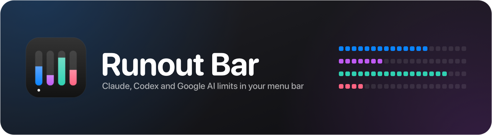
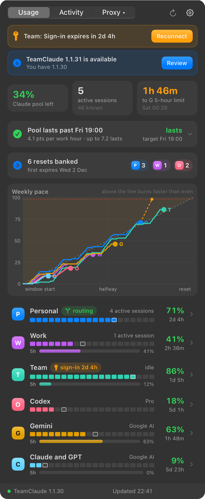
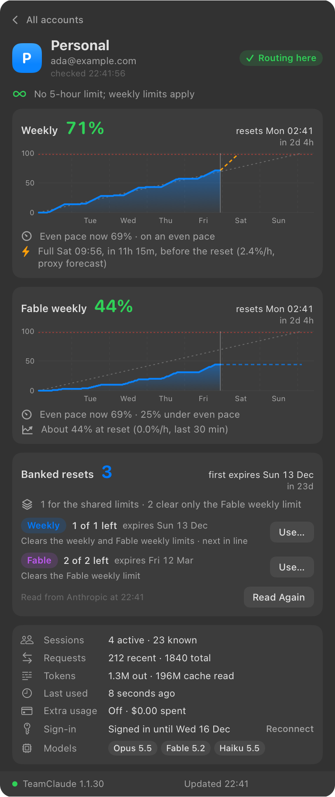
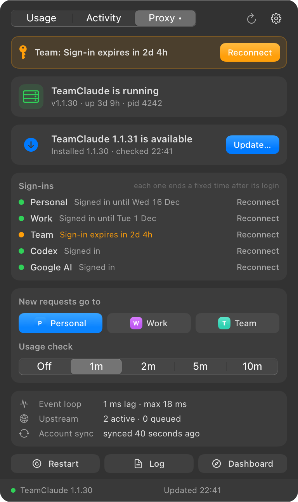

<h1 align="center">
  
</h1>

<p align="center">
  <a href="https://github.com/RobinVivant/runout-bar/actions/workflows/ci.yml"></a>
  <a href="LICENSE"></a>
  
</p>

Runout Bar is a macOS menu bar app that shows Claude subscription usage from a local
[TeamClaude](https://github.com/KarpelesLab/teamclaude) proxy, Codex rate limits and Google AI
subscription quotas as colored level bars, with the time your whole Claude pool runs out, a pace
dashboard, routing controls, banked resets and one-click TeamClaude updates.

<p align="center">
  
  
  
</p>

The screenshots show the made-up accounts of [demo mode](#try-it-without-an-account).

## Quickstart

You need macOS 15 or later on Apple silicon. On a Mac without
[TeamClaude](https://github.com/KarpelesLab/teamclaude), the app installs it on its first launch,
which needs Node.js 20 or later (`brew install node`); a TeamClaude you already have is used as it
is. The Codex and [Antigravity](https://antigravity.google) (`agy`) CLIs are optional.

```bash
curl -fsSL https://raw.githubusercontent.com/RobinVivant/runout-bar/main/scripts/get.sh | bash
```

The [script](scripts/get.sh) downloads the latest release, checks it against its SHA-256 file and
its signature, copies `Runout Bar.app` to `~/Applications` and opens it. One bar per account
appears in the menu bar; click it for the dashboard. The first launch from an Applications folder
turns on Open at Login. Run the same line again to update.

After a first TeamClaude install the popover shows **Add Account**, which opens claude.ai to sign
in. The proxy starts once it has that account, and again at every login. Claude Code then runs
through it with `~/.local/bin/teamclaude run`.

Version 1.0 was called Usage Bar. The same line updates it: it removes `Usage Bar.app`, and the
first launch of Runout Bar moves your config, history and settings to the new names.

### Download by hand

1. Download `Runout-Bar-<version>-arm64.zip` from the
   [latest release](https://github.com/RobinVivant/runout-bar/releases/latest) and unzip it.
2. Move `Runout Bar.app` to `/Applications` or `~/Applications`.
3. Open it. macOS blocks the first launch of a copy downloaded with a browser, because the build
   is not notarized by Apple: choose **Done**, open **System Settings > Privacy & Security**,
   scroll to the message about Runout Bar and choose **Open Anyway**. From a terminal, this does
   the same:

   ```bash
   xattr -dr com.apple.quarantine "/Applications/Runout Bar.app"
   ```

If you update from Usage Bar 1.0 by hand, delete `Usage Bar.app` yourself.

The install script does not hit this block: `curl` does not mark its downloads as coming from
the internet, so macOS has nothing to check.

### Build from source

With a Swift 6 toolchain (Xcode or the Command Line Tools), this builds `Runout Bar.app`, copies
it to `~/Applications` and opens it. A build made on your own Mac opens without the block.

```bash
git clone https://github.com/RobinVivant/runout-bar.git
cd runout-bar
scripts/install.sh
```

### Try it without an account

Demo mode runs the app on made-up accounts, without TeamClaude, Codex or Google AI. It reads none
of them, saves no history, sends no notifications, and every action answers "Demo data: nothing
was changed".

```bash
swift run RunoutBar --demo
```

## What it shows

- **Menu bar** :
  one level bar per account, filled to its fullest limit window. Bars turn orange
  at 90% and red at 98% (TeamClaude's switch threshold), and grey when a reading is stale. A dot
  marks the account that new requests go to, and a warning triangle means the proxy is down.
  Beside the bars, the time the whole Claude pool is projected to run out, such as `Thu 15:40`:
  green when it lasts past the end of the work week, orange when it runs out before, red when it
  runs out today or is out. A green `✓` means it lasts more than six days. It is hidden while
  readings are stale or History is too short. In **Level bars and percent** mode, the routed
  account's percentage is shown beside the bars. Right click for Refresh, Open Dashboard and Quit.
- **Usage tab**: Claude capacity left, active sessions and the next projected limit; the pool
  run-out card with the projected time, the target, the margin and the pace that would last; a weekly
  pace chart that compares each account with an even burn through its window and projects where
  it lands; the banked resets each account holds; and one row per account. A Google AI
  subscription appears as two quota groups (`Gemini` and `Claude and GPT`), each with its own
  5-hour and weekly limits. A row's figure is the
  account's fullest window, with the time until that window resets; its weekly and 5-hour bars
  each take the color of their own level, so a weekly bar cleared by a banked reset is not red
  because the 5-hour window filled. Click a row for its
  timeline per window, forecast, banked resets, sessions, requests, tokens and models (including
  the **Models sharing these limits** card for Google AI groups, and `starts on first use` for
  untouched windows). Click the
  run-out card for what the time is built from: the pace, the budget, the work week and what each
  account has left.
- **Activity tab**: weekly usage over 6 hours, 24 hours or 7 days, plus per-account activity and
  a token breakdown.
- **Pointer**: point at a chart for the reading at that time, and at a figure for what it is made
  of. Whatever lights up under the pointer acts on a click: a line in the pace chart, a stat tile,
  a legend entry or an activity card opens its account or tab, and the footer opens the Proxy tab.
- **Proxy tab**: proxy status, the update card, every sign-in with its end date, routing
  (`teamclaude switch`), the usage check interval (`teamclaude probe`), event loop and upstream
  health, and Restart, Log and Dashboard buttons.
- **Sign-ins**: a banner with a **Reconnect** (or **Sign In**) button from 5 days before a Claude
  account's sign-in ends, and when a provider refuses a Claude, Codex or Google AI sign-in. The
  account's row and detail view say how long it has left.
- **Notifications**: an account passes 90%, reaches its limit or comes back; every Claude account
  is full; a sign-in is 5 days or 24 hours from its end, has expired or was refused; the proxy
  stops responding (two failed reads in a row) or recovers; a new TeamClaude release is out (once
  per version). Restarts started from the app do not notify. Click a sign-in notification to
  open that sign-in in the popover.

Pace uses the proxy's own forecast when it has one, then the rate measured over the last
30 minutes, then the average since the window began.

## How it works

- **Pool run-out**: the pool runs out when every Claude account's weekly window is at
  TeamClaude's switch threshold. The app measures the pace over the last two workdays, burns it
  during work hours only, and gives each account its capacity back at its own reset. The target
  is the end of the work week. See [docs/pool-run-out.md](docs/pool-run-out.md).
- **Banked resets**: a banked reset clears an account's limits before their own reset. The app
  lists them for Claude and Codex accounts and spends one when you confirm; a spend cannot be
  undone. Its calls to Anthropic go through one queue that waits out rate limits and shows the
  wait. See [docs/banked-resets.md](docs/banked-resets.md).
- **Sign-ins**: a Claude sign-in ends a fixed time after its login, about 30 days, and the
  account then leaves rotation and its readings stop. TeamClaude reports the end date, and the
  app reads a refused Codex or Google AI CLI login from the error of its limits read. **Reconnect**
  (or **Sign In**) runs `teamclaude login --oauth`, `teamclaude login --codex`, `codex login` or
  `agy acp --stdio` (`authenticate`), which opens the browser with a local callback so no code has
  to be pasted back; the running proxy takes a renewed TeamClaude sign-in without a restart. The
  login renews the account the browser is signed in to, so sign in to claude.ai, chatgpt.com or
  accounts.google.com as that account first; the app says so when another account was renewed
  instead. A long-lived token is renewed in a terminal, and the app copies its command.
- **TeamClaude install**: when the app finds no TeamClaude CLI, no LaunchAgent, no TeamClaude
  config and nothing listening on the proxy's port, it installs the latest release without asking:
  the package with npm and a link to its CLI. It does this once per Mac, and never again after it
  has seen a TeamClaude there. A proxy without an account exits as it starts, so the LaunchAgent
  that `teamclaude service install` writes comes after **Add Account**. With traces of another
  copy, or after a removal, the app shows an **Install** button instead; after a failed attempt,
  **Try Again**. See [docs/teamclaude-updates.md](docs/teamclaude-updates.md#first-install).
- **TeamClaude updates**: the app asks the npm registry for the latest release every 6 hours.
  **Update…** asks for confirmation, installs the release with npm and restarts the proxy. See
  [docs/teamclaude-updates.md](docs/teamclaude-updates.md).

## Configuration

Everything works without a config file. To name, color and order accounts, create
`~/.config/runout-bar/config.json`, or choose **Edit Accounts…** in the settings menu to write a
starter file from the current accounts:

```json
{
  "accounts": {
    "me@example.com": { "letter": "P", "label": "Personal", "color": "#0a84ff", "noFiveHourLimit": true },
    "work@example.com": { "letter": "W", "label": "Work", "color": "#bf5af2" },
    "openai": { "letter": "O", "label": "Codex", "color": "#ff6482" },
    "google.gemini": { "letter": "G", "label": "Gemini", "color": "#e09f00" },
    "google.claude-and-gpt": { "letter": "C", "label": "Claude and GPT", "color": "#64d2ff" }
  },
  "order": ["me@example.com", "work@example.com", "openai", "google.gemini", "google.claude-and-gpt"]
}
```

Account keys are TeamClaude account names; `openai` is the Codex login, and `google.<group>` is a
Google AI quota group (such as `google.gemini` and `google.claude-and-gpt`). Choose **Reload
Accounts** after editing.

| Key | Default | Meaning |
|-----|---------|---------|
| `accounts.<name>.letter`, `label`, `color`, `symbol` | From the name and a palette | Badge letter, display name, `#rrggbb` color, SF Symbol |
| `accounts.<name>.noFiveHourLimit` | `false` | The account has no 5-hour session window, for example a verified subscription |
| `order` | Proxy order, followed by Codex and Google AI | Display order of account keys |
| `teamclaude` | `~/.local/bin/teamclaude` | TeamClaude CLI; also looked for in `/opt/homebrew/bin`, `/usr/local/bin`, where the LaunchAgent runs it from, and in the Volta, Bun, pnpm, npm and nvm folders |
| `teamclaudeInstallDir` | `~/.local/share/teamclaude` | npm prefix that holds the proxy |
| `npm` | `/opt/homebrew/bin/npm` | npm used for the install and for updates |
| `node` | `/opt/homebrew/bin/node` | Node used to list and spend Claude resets and to count TeamClaude's accounts, and checked before an install. Its folder comes first on the `PATH` of the TeamClaude commands the app runs |
| `proxyService` | `com.karpeleslab.teamclaude` | LaunchAgent label to restart |
| `proxyLog` | `~/Library/Logs/teamclaude.log` | Log opened by the Log button |
| `dashboard` | `http://127.0.0.1:3456/teamclaude/dashboard` | Page opened by Dashboard |
| `codex` | Searched in `~/.local/bin`, `/opt/homebrew/bin`, `/usr/local/bin` | Codex CLI; `""` hides the Codex row |
| `agy` | Searched in `~/.local/bin`, `/opt/homebrew/bin`, `/usr/local/bin` | Antigravity CLI; `""` hides the Google AI rows |
| `workWeek` | `{"days": ["Mon", "Tue", "Wed", "Thu", "Fri"], "start": "09:00", "end": "19:00"}` | Work days and hours for the pool run-out; the last day's `end` is the target |

Without `noFiveHourLimit`, an account whose 5-hour reading stops updating while its weekly
reading stays fresh drops the old 5-hour value and says "No 5-hour window reported since" in its
detail view.

The settings menu also sets what the menu bar shows (level bars, level bars and percent, or
letters and numbers), whether numbers count used or remaining capacity, the pool run-out time,
notifications, and Open at Login.

## What it reads and sends

- `teamclaude status --json` every 60 seconds. The CLI adds the proxy key itself.
- `codex app-server` (`account/rateLimits/read`) about every 2 minutes, and
  `account/rateLimitResetCredit/consume` when you spend a Codex reset.
- `agy -p "/usage" --output-format json` about every 5 minutes when the Antigravity CLI is
  installed. It is a read-only command: no model runs, the CLI holds the Google sign-in, and this
  app never sees a credential.
- `teamclaude login`, `codex login` or `agy acp --stdio` (`authenticate`), only when you choose
  Sign In or Reconnect. The command opens the provider's sign-in page in the browser and saves the
  new sign-in itself; the app reads neither the page nor the tokens.
- `npm install`, once, on a Mac that has no TeamClaude, and when you choose Install.
  `teamclaude service install` follows once TeamClaude has an account, when no LaunchAgent starts
  it yet.
- The npm registry, for the latest TeamClaude version. This is the app's only network call of
  its own.
- Anthropic's usage and reset endpoints, only when you list or spend a Claude reset. A short Node
  script reads one account's token through TeamClaude's config loader and keeps it in its own
  process; the app itself never reads TeamClaude's config or credentials.
- TeamClaude's account count, while its proxy does not answer, and the proxy's reload endpoint
  after a Codex login in TeamClaude. A second Node script does both through the same loader and
  prints a count or a yes or no, nothing from the config.
- `~/Library/Application Support/RunoutBar/history.json`: 8 days of samples for the charts and
  pace.
- `~/Library/Application Support/RunoutBar/alerts.json`: what was last notified.

There is no telemetry. [SECURITY.md](SECURITY.md) says how to report a vulnerability.

To remove the app, choose Quit in its right-click menu, then delete
`~/Applications/Runout Bar.app`, `~/Library/Application Support/RunoutBar` and
`~/.config/runout-bar`. To remove a TeamClaude that the app installed, run
`~/.local/bin/teamclaude service uninstall`, then delete `~/.local/share/teamclaude` and
`~/.local/bin/teamclaude`. Its accounts are in `~/.config/teamclaude.json`.

## Development

```bash
swift test                                            # the RunoutCore test suite
swift run RunoutBar --demo                            # the app on made-up accounts
swift run RunoutBar --snapshot /tmp/runout-bar --demo # every screen in dark and light, as PNG files
scripts/build-app.sh                                  # the release app bundle in build/
```

- `Sources/RunoutCore`: status, Codex and Google AI parsing, pace and run-out models, Claude
  resets and the API queue, history, alerts, update logic and process helpers. Covered by
  `Tests/RunoutCoreTests`.
- `Sources/RunoutBar`: the status item, popover and SwiftUI views.
- `scripts/`: build, install, icon and brand image scripts.
- `docs/`: how the projection, the resets and the updates work.

Without `--demo`, `swift run RunoutBar` reads your real TeamClaude, Codex and Google AI, and
`--snapshot` renders your real accounts.

## Contributing

Bug reports and pull requests are welcome. [CONTRIBUTING.md](CONTRIBUTING.md) covers the setup,
the checks and the guidelines, and the [Code of Conduct](CODE_OF_CONDUCT.md) applies to every
project space.

## License

[MIT](LICENSE).

Runout Bar is an independent project. It is not affiliated with or endorsed by Anthropic, OpenAI,
Google or the TeamClaude authors.
