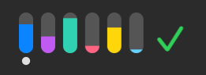

<h1 align="center">
  
</h1>

<p align="center">
  <a href="https://github.com/RobinVivant/usage-bar/actions/workflows/ci.yml"></a>
  <a href="LICENSE"></a>
  
</p>

Usage Bar is a macOS menu bar app that shows Claude subscription usage from a local
[TeamClaude](https://github.com/KarpelesLab/teamclaude) proxy and Codex rate limits as colored
level bars, with a pace dashboard, routing controls, banked resets and one-click TeamClaude
updates.

<p align="center">
  
  
  
</p>

The screenshots show the made-up accounts of [demo mode](#try-it-without-an-account).

## Quickstart

You need macOS 15 or later on Apple silicon and
[TeamClaude](https://github.com/KarpelesLab/teamclaude) installed with its LaunchAgent. The Codex
CLI is optional, and so is Node, which only the Claude reset button uses.

1. Download `Usage-Bar-<version>-arm64.zip` from the
   [latest release](https://github.com/RobinVivant/usage-bar/releases/latest) and unzip it.
2. Move `Usage Bar.app` to `/Applications` or `~/Applications`.
3. Open it. macOS blocks the first launch, because the build is not notarized by Apple: choose
   **Done**, open **System Settings > Privacy & Security**, scroll to the message about Usage Bar
   and choose **Open Anyway**.

One bar per account appears in the menu bar; click it for the dashboard. The first launch from an
Applications folder turns on Open at Login.

To allow the app from a terminal instead of step 3:

```bash
xattr -dr com.apple.quarantine "/Applications/Usage Bar.app"
```

### Build from source

With a Swift 6 toolchain (Xcode or the Command Line Tools), this builds `Usage Bar.app`, copies
it to `~/Applications` and opens it. A build made on your own Mac opens without the block.

```bash
git clone https://github.com/RobinVivant/usage-bar.git
cd usage-bar
scripts/install.sh
```

### Try it without an account

Demo mode runs the app on made-up accounts, without TeamClaude or Codex. It reads neither of
them, saves no history, sends no notifications, and every action answers "Demo data: nothing was
changed".

```bash
swift run UsageBar --demo
```

## What it shows

- **Menu bar** :
  one level bar per account, filled to its fullest limit window. Bars turn orange
  at 90% and red at 98% (TeamClaude's switch threshold), and grey when a reading is stale. A dot
  marks the account that new requests go to, and a warning triangle means the proxy is down.
  Beside the bars, the time the whole Claude pool is projected to run out, such as `Thu 15:40`:
  green when it lasts past the end of the work week, orange when it runs out before, red when it
  runs out today or is out. A green `✓` means it lasts more than six days. It is hidden while
  readings are stale or History is too short. Right click for Refresh, Open Dashboard and Quit.
- **Usage tab**: Claude capacity left, active sessions and the next projected limit; the pool
  run-out card with the projected time, the target, the margin and the pace that would last; a weekly
  pace chart that compares each account with an even burn through its window and projects where
  it lands; the banked resets each account holds; and one row per account. Click a row for its
  timeline per window, forecast, banked resets, sessions, requests, tokens and models.
- **Activity tab**: weekly usage over 6 hours, 24 hours or 7 days, plus per-account activity and
  a token breakdown.
- **Proxy tab**: proxy status, the update card, routing (`teamclaude switch`), the usage check
  interval (`teamclaude probe`), event loop and upstream health, and Restart, Log and Dashboard
  buttons.
- **Notifications**: an account passes 90%, reaches its limit or comes back; every Claude account
  is full; the proxy stops responding (two failed reads in a row) or recovers; a new TeamClaude
  release is out (once per version). Restarts started from the app do not notify.

Pace uses the proxy's own forecast when it has one, then the rate measured over the last
30 minutes, then the average since the window began.

## How it works

- **Pool run-out**: the pool runs out when every Claude account's weekly window is at
  TeamClaude's switch threshold. The app measures the pace over the last two workdays, burns it
  during work hours only, and gives each account its capacity back at its own reset. The target
  is the end of the work week. See [docs/pool-run-out.md](docs/pool-run-out.md).
- **Banked resets**: a banked reset clears an account's limits before their own reset. The app
  lists them for Claude and Codex accounts and spends one when you confirm; a spend cannot be
  undone. Its calls to Anthropic go through one queue that waits out rate limits and shows the
  wait. See [docs/banked-resets.md](docs/banked-resets.md).
- **TeamClaude updates**: the app asks the npm registry for the latest release every 6 hours.
  **Update…** asks for confirmation, installs the release with npm and restarts the proxy. See
  [docs/teamclaude-updates.md](docs/teamclaude-updates.md).

## Configuration

Everything works without a config file. To name, color and order accounts, create
`~/.config/usage-bar/config.json`, or choose **Edit Accounts…** in the settings menu to write a
starter file from the current accounts:

```json
{
  "accounts": {
    "me@example.com": { "letter": "P", "label": "Personal", "color": "#0a84ff", "noFiveHourLimit": true },
    "work@example.com": { "letter": "W", "label": "Work", "color": "#bf5af2" },
    "openai": { "letter": "O", "label": "Codex", "color": "#ff6482" }
  },
  "order": ["me@example.com", "work@example.com", "openai"]
}
```

Account keys are TeamClaude account names; `openai` is the Codex login. Choose **Reload
Accounts** after editing.

| Key | Default | Meaning |
|-----|---------|---------|
| `accounts.<name>.letter`, `label`, `color`, `symbol` | From the name and a palette | Badge letter, display name, `#rrggbb` color, SF Symbol |
| `accounts.<name>.noFiveHourLimit` | `false` | The account has no 5-hour session window, for example a verified subscription |
| `order` | Proxy order | Display order of account keys |
| `teamclaude` | `~/.local/bin/teamclaude` | TeamClaude CLI |
| `teamclaudeInstallDir` | `~/.local/share/teamclaude` | npm prefix that holds the proxy |
| `npm` | `/opt/homebrew/bin/npm` | npm used for updates |
| `node` | `/opt/homebrew/bin/node` | Node used to list and spend Claude resets |
| `proxyService` | `com.karpeleslab.teamclaude` | LaunchAgent label to restart |
| `proxyLog` | `~/Library/Logs/teamclaude.log` | Log opened by the Log button |
| `dashboard` | `http://127.0.0.1:3456/teamclaude/dashboard` | Page opened by Dashboard |
| `codex` | Searched in `~/.local/bin`, `/opt/homebrew/bin`, `/usr/local/bin` | Codex CLI; `""` hides the Codex row |
| `workWeek` | `{"days": ["Mon", "Tue", "Wed", "Thu", "Fri"], "start": "09:00", "end": "19:00"}` | Work days and hours for the pool run-out; the last day's `end` is the target |

Without `noFiveHourLimit`, an account whose 5-hour reading stops updating while its weekly
reading stays fresh drops the old 5-hour value and says "No 5-hour window reported since" in its
detail view.

The settings menu also sets what the menu bar shows (level bars, level bars and percent, or
letters and numbers), whether numbers count used or remaining capacity, the pool run-out time,
notifications, and Open at Login.

## What it reads and sends

- `teamclaude status --json` every 60 seconds. The CLI adds the proxy key itself.
- `codex app-server` (`account/rateLimits/read`) about every 2 minutes, and
  `account/rateLimitResetCredit/consume` when you spend a Codex reset.
- The npm registry, for the latest TeamClaude version. This is the app's only network call of
  its own.
- Anthropic's usage and reset endpoints, only when you list or spend a Claude reset. A short Node
  script reads one account's token through TeamClaude's config loader and keeps it in its own
  process; the app itself never reads TeamClaude's config or credentials.
- `~/Library/Application Support/UsageBar/history.json`: 8 days of samples for the charts and
  pace.
- `~/Library/Application Support/UsageBar/alerts.json`: what was last notified.

There is no telemetry. [SECURITY.md](SECURITY.md) says how to report a vulnerability.

To remove the app, choose Quit in its right-click menu, then delete
`~/Applications/Usage Bar.app`, `~/Library/Application Support/UsageBar` and
`~/.config/usage-bar`.

## Development

```bash
swift test                                          # the UsageCore test suite
swift run UsageBar --demo                           # the app on made-up accounts
swift run UsageBar --snapshot /tmp/usage-bar --demo # every screen in dark and light, as PNG files
scripts/build-app.sh                                # the release app bundle in build/
```

- `Sources/UsageCore`: status and Codex parsing, pace and run-out models, Claude resets and the
  API queue, history, alerts, update logic and process helpers. Covered by `Tests/UsageCoreTests`.
- `Sources/UsageBar`: the status item, popover and SwiftUI views.
- `scripts/`: build, install, icon and brand image scripts.
- `docs/`: how the projection, the resets and the updates work.

Without `--demo`, `swift run UsageBar` reads your real TeamClaude and Codex, and `--snapshot`
renders your real accounts.

## Contributing

Bug reports and pull requests are welcome. [CONTRIBUTING.md](CONTRIBUTING.md) covers the setup,
the checks and the guidelines, and the [Code of Conduct](CODE_OF_CONDUCT.md) applies to every
project space.

## License

[MIT](LICENSE).

Usage Bar is an independent project. It is not affiliated with or endorsed by Anthropic, OpenAI
or the TeamClaude authors.
